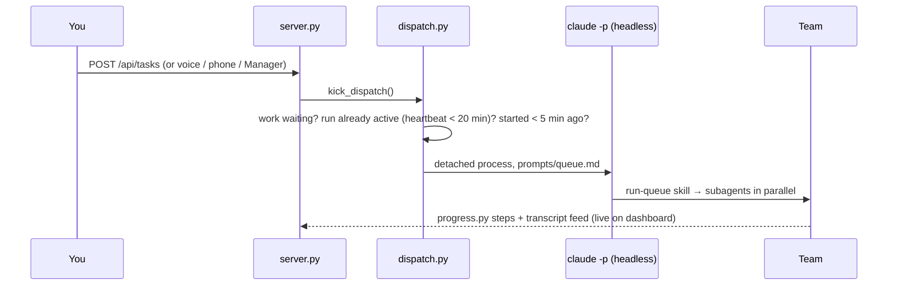

# AiFlow Dashboard

**A personal AI operations center: an autonomous four-agent team, a voice assistant, and a smart-home hub,
run from one local dashboard and a phone app.**

AiFlow runs a small business's busywork without supervision. You drop a task in plain English, a Manager agent
decides who handles it, and Researcher, Web builder and Marketer agents do the work. They hand results to each
other and wait for your approval before anything goes public or costs money. The same dashboard hosts
**Jarvis**, a spoken assistant you can talk to hands-free. Jarvis briefs you on the team, the weather and the
news, answers questions, and controls your cameras, lights, thermostat and garage through Home Assistant.

It is built entirely on [Claude Code](https://claude.com/claude-code) primitives: subagents, skills, `CLAUDE.md`
rules, permission policies, scheduled tasks, the headless CLI and claude.ai artifacts. The rest is one dependency-free
Python server and plain HTML and JavaScript. It has **no API keys, no build step and no hosted backend**.

| | |
|---|---|
| **Stack** | Python 3 standard library · vanilla JS/HTML/CSS · Canvas 2D · Web Speech API · Claude Code CLI · Home Assistant REST API |
| **Size** | ~2,400-line single-page dashboard · ~1,900 lines of Python across 8 modules · 4 agents · 9 skills · 6 schedules |
| **Runs on** | A Windows PC (dashboard, agents, Home Assistant VM) plus any phone (claude.ai artifact) |
| **Live use** | It runs a real web design lead-generation pipeline for businesses in Berkeley County, WV |

---

## Contents
1. [A day with AiFlow](#a-day-with-aiflow)
2. [Features](#features)
3. [Architecture](#architecture)
4. [How the pieces work](#how-the-pieces-work)
5. [Security and safety model](#security-and-safety-model)
6. [Engineering decisions and lessons](#engineering-decisions-and-lessons)
7. [Setup](#setup)
8. [Dashboard API](#dashboard-api)
9. [Repository layout](#repository-layout)
10. [Extending it](#extending-it)
11. [Limitations and roadmap](#limitations-and-roadmap)

---

## A day with AiFlow

| Time | What happens | Who |
|---|---|---|
| **7:00** | The **morning brief** collects cited news on the topics in `tasks/recurring.md`. | Researcher (scheduled) |
| **Morning** | You open the dashboard and press **Brief me**. Jarvis reads out the weather, what the team finished overnight, what's waiting for approval, and what's blocked. | Jarvis |
| **8:33** | The **Manager plans the day**. It reviews yesterday's deliverables (✅ or ⚠), plans toward the goals in `tasks/goals.md`, and assigns new work, for example "find 10 local businesses without websites". | Manager (scheduled) |
| **Any time** | You add a task by typing it or saying it to Jarvis. The **event-driven dispatcher** starts a headless run within seconds; nothing waits for a fixed schedule. | You → Dispatcher |
| **During the day** | The pipeline flows. The Researcher qualifies leads, the Web builder makes a **local demo site** for each lead, and the Marketer drafts outreach emails and social posts that show the demo. Each step is visible live on the AiFlow page. | Team |
| **When you disagree** | You click **✎ Feedback** on any step. It becomes a high-priority `Revise:` task for the same agent, who assesses it, fixes the deliverable in place and notes what changed. | You → Agent |
| **Approvals** | Posts, ad campaigns (with proposed spend), email sequences and site launches wait on the **Approvals** page. You approve or reject them from the PC or your phone. | You |
| **Hands-free** | "Jarvis, set the thermostat to 70." "Show me the driveway camera." "What's the news?" "Turn off all the lights." | Jarvis + Home Assistant |
| **18:06** | The **evening report** covers decisions you need to make, each agent's day, and progress toward the goals. | Manager (scheduled) |

**Real results.**
- In one unattended run the Researcher checked 28 candidate businesses across several directories, ruled out 5
  (closed, out of area or already had a website) and delivered 23 qualified leads with evidence levels.
- A complete local demo site for a bakery lead was built about 6 minutes after the task was queued, with no one watching.

---

## Features

### 1. An autonomous AI team (`.claude/agents/`)

Four Claude Code subagents, each with its own charter, playbook (skill) and **least-privilege tool set**:

| Agent | Role | Tags | Tools |
|---|---|---|---|
| **Manager** | Triages incoming tasks, plans toward the goals, assigns work, reviews quality and writes the daily report | `[plan]` `[auto]` | Files and shell only. **No web access**, so outside content can't steer the team's decisions. |
| **Researcher** | Leads, markets, competitors, pricing; briefs; document and data work | `[research]` `[brief]` `[docs]` | Files, shell, web search and page fetching |
| **Web builder** | Static, mobile-first, accessible demo sites with local SEO. Demos stay **local** (`outputs/sites/`); a real client site is built and deployed only after the business agrees. | `[web]` `[code]` | Files, shell, web (docs) |
| **Marketer** | Facebook/Instagram, TikTok, Google Ads and email outreach: ready-to-publish drafts, character-counted ad copy, CAN-SPAM-compliant email | `[marketing]` | Files, shell, web |

- **"Team decides" routing.** Tasks don't need a type. The Manager triages `[auto]` tasks, either routing each to one
  agent or splitting it into steps, and the dashboard records every hand-off (*You → Manager → Web builder*).
- **Guardrails on the Manager.** It can have at most 8 open tasks and add at most 6 new ones a day, enforced in
  code (`dashboard/team.py`). It never recreates a task you removed, and it can be paused from the goals file.
- **Approvals.** Agents never publish, post, send or spend. They submit request files, and only the owner's decision
  in the dashboard moves an item forward. Approved Netlify deploys are carried out automatically by a schedule;
  approved posts, ads and emails are published by you.

### 2. Control-room dashboard (`dashboard/index.html`)

A dark, glass-panel interface built as one HTML file with no framework.

- **Neural core.** A real-time canvas rendering of a brain modelled from a side-view silhouette:
  - 1,880 points and a nearest-neighbour wire mesh
  - glowing hotspots
  - lightning "shocks" that chain from synapse to synapse
  - one slow full rotation about every 90 seconds

  It reacts to the system's state: it pulses faster while the team is working, while Jarvis is listening, thinking or speaking.
- **AiFlow.** One Overview block summarizes the team (who's working, queue size, done today, approvals pending). Clicking it opens
  the AiFlow page: one box per agent with **Active / Done** tabs, the hand-off trail for each task, and inline
  feedback. Clicking any task opens a **project view** that traces every step of that project across agents to the
  current point, with buttons to open results and demo sites.
- **Hub blocks.** Weather, News, Cameras and Smart devices, each opening its own page (see below).
- **Task pages.** Queued, In progress (live step bars and a plain-English "what Claude is doing" feed), Done,
  Blocked (retry with an answer, or dismiss), Approvals, Team & goals, and Resources (outputs, logs, analytics charts).

### 3. Jarvis: voice assistant

- **Hands-free conversation.** Press **Talk** once, then speak naturally. Jarvis listens, answers aloud and listens
  again until you say "that's all". It uses the browser's Web Speech API (speech-to-text and text-to-speech) with a
  British male voice preset and adjustable speed, pitch and form of address.
- **Instant paths for common requests** (no model call): the status recap, home weather, top headlines and smart-home commands.
- **Everything else** goes to Claude through the headless CLI (`claude -p --resume`), which keeps the conversation
  going across turns. Each request carries live context: the date and time, the home location, the current weather,
  about 24 fresh headlines, and the state of every smart-home device. Jarvis can search the web for anything recent,
  add tasks and send feedback to the team through request files. It is never allowed to approve, publish or spend.
- A spoken filler ("Checking now, sir.") covers slower answers, the way a person would.

### 4. Home hub

| Page | Source | What you get |
|---|---|---|
| **Weather** | Open-Meteo (no key) | Current conditions, a 24-hour strip, a 7-day forecast with sunrise, UV and wind; read aloud on request |
| **News** | NPR, BBC and Ars Technica RSS | Top stories, U.S., World, Business, Tech and Science; "Read me the headlines"; "Ask Jarvis" about any story |
| **Cameras** | Home Assistant camera proxy | A tile per camera, refreshed every few seconds; click to go full screen; Jarvis can show a camera by name |
| **Smart devices** | Home Assistant REST API | Thermostat (± set point, modes), garage and doors, locks, lights (switch, brightness, colors), plugs, speakers, scenes |

Voice control examples Jarvis understands: *"dim the porch light to 40 percent"*, *"make the bedroom strip purple"*,
*"set the thermostat to 72"*, *"switch the heat to cool"*, *"are any lights on?"*, *"is the garage door open?"*,
*"show me the cameras"*. For *"open the garage"* Jarvis asks *"Should I open the Garage Door?"* and acts only on a spoken yes.

### 5. Phone app (`phone/ai-workflow-phone.html`)

A private **claude.ai artifact** that mirrors the PC and can be added to the home screen. It has five tabs:
- **Core:** neural core, Brief me, crew cards with feedback, timeline and project reader
- **Jarvis:** chat with tools for adding tasks and giving feedback
- **Queue**
- **Approve:** approve or reject from anywhere
- **Results:** reports, demo sites and blocked items

It syncs with the PC through the artifact's owner-only document database (see [Phone sync](#phone-sync)).

---

## Architecture

```mermaid
flowchart LR
  subgraph Owner
    UI[Dashboard<br/>127.0.0.1:8765]
    MIC((Voice<br/>Jarvis))
    PH[Phone app<br/>claude.ai artifact]
  end

  subgraph PC["Windows PC"]
    SRV[server.py<br/>stdlib HTTP API]
    DSP[dispatch.py<br/>event-driven runs]
    CLI[[Claude Code CLI<br/>headless -p]]
    SCH[[Scheduled tasks<br/>brief · plan · deploys · digest · sync]]
    subgraph Team[".claude/agents + skills"]
      MGR[Manager]
      RES[Researcher]
      WEB[Web builder]
      MKT[Marketer]
    end
    FILES[(tasks/*.md · approvals.json<br/>history.jsonl · status.json)]
    OUT[(outputs/ · logs/)]
    FEED[feed.py<br/>transcripts → live feed]
    HUB[hub.py<br/>weather · news]
    HA[homeassistant.py<br/>bridge]
    VM[(Home Assistant<br/>VirtualBox VM)]
  end

  EXT[(Open-Meteo · RSS)]
  DEV[(Ring · ecobee · Govee<br/>Alexa · garage)]
  DB[(Artifact DB<br/>owner-only)]

  UI <--> SRV
  MIC --> UI
  SRV --> DSP --> CLI --> Team
  SCH --> Team
  Team <--> FILES
  Team --> OUT
  Team -. progress.py .-> FILES
  CLI -. transcripts .-> FEED --> SRV
  SRV -- /api/ask --> CLI
  SRV --> HUB --> EXT
  SRV --> HA --> VM --> DEV
  SCH -- phone_sync.py --> DB <--> PH
```

| Layer | Component | Responsibility |
|---|---|---|
| Interface | `index.html` | Single-page app: routing, rendering, neural core, voice loop, hub pages |
| API | `server.py` | Local HTTP API, task-file parsing and editing, approvals, feedback, Jarvis requests |
| Orchestration | `dispatch.py`, scheduled tasks | Starts a headless team run when work is waiting; timed jobs for brief, plan, deploys and digest |
| Agents | `.claude/agents/*.md`, `.claude/skills/*` | Roles, tool permissions and step-by-step playbooks |
| Coordination | `team.py` | Agents' only write path for tasks and approval requests (JSON request files, file lock, rate limits) |
| Observability | `progress.py`, `feed.py` | Step and heartbeat reporting; session transcripts turned into a plain-English live feed |
| Hub | `hub.py`, `homeassistant.py` | Weather, forecast, news; Home Assistant bridge with an allowlist and voice-command parser |
| Mobile | `phone_sync.py`, phone artifact | State snapshot out, tasks, feedback and decisions in |
| State | Markdown and JSON files | Human-readable, diffable and editable by hand. No database on the PC. |

---

## How the pieces work

### Task lifecycle
Tasks are lines in `tasks/inbox.md`, added from the dashboard, by voice, from the phone or by the Manager:

```markdown
## Queue
- [ ] [auto] (high) Win Glazed Empire Bakery as a client — they have no website
  Owner feedback: lead with the custom cake photos
```

| Marker | Meaning |
|---|---|
| `- [ ]` | queued |
| `- [~]` | claimed by a run (parallel runs skip it; reset automatically after 3 hours) |
| `- [x]` | done, moved to `tasks/done.md` with a link to its output |
| `- [!] … BLOCKED: reason` | couldn't finish; **Retry** re-queues it with your answer attached |
| `- [-]` | blocked item dismissed |

Runs take `Revise:` tasks first, then the rest by priority and then from top to bottom. Every hand-off is recorded in
`tasks/history.jsonl` with its origin (You, Manager, You via feedback, You via phone) and the project it belongs to,
which powers the trails and project views.

### Event-driven dispatch

- The process is fully detached, so it survives the dashboard closing.
- If the CLI isn't installed or signed in, the 30-minute *Dispatch check* schedule falls back to the scheduled queue task.

### Owner feedback loop
**✎ Feedback** on any task, in a crew box or the project view, posts to `/api/feedback`:
- **Task not started yet:** the feedback is appended to it as `Owner feedback: …`.
- **Otherwise:** it becomes a high-priority `Revise: <task>` for the **same agent**, carrying the original task,
  the result path and the project.

`CLAUDE.md` defines the revision protocol: **assess → fix in place → note what changed**. Feedback that would break a
hard rule ("just post it") is partly declined, with an explanation.

### Voice pipeline
```
mic → SpeechRecognition → intent check
   ├─ "that's all" ............ end the conversation
   ├─ pending confirmation .... "yes" → /api/ha/call {confirm: true}
   ├─ device words ............ /api/ha/command → speak result / ask to confirm / show camera
   ├─ recap / weather / news .. answered locally, no model call
   └─ anything else ........... /api/ask → claude -p --resume (persona + live context) → speechSynthesis
```

### Smart-home bridge (`homeassistant.py`)
- **Allowlist.** Each device domain (light, switch, fan, climate, cover, lock, media_player, scene,
  alarm_control_panel) has a fixed set of callable services and allowed data keys. Anything else is refused.
- **Confirmation.** Garage doors, locks and alarms return `needs_confirm` until the owner confirms. Alarms can be armed
  but never disarmed from the dashboard.
- **Voice parser.** It is rule-based. Devices are matched by word overlap with each device's name, and ties apply to the whole
  group ("the porch lights"). The last mode mentioned wins ("switch the heat to cool"). Questions are answered and never acted on.
  An offline test harness covers it with stubbed devices.
- **Camera proxy.** `/api/ha/camera` streams snapshots from Home Assistant, so the token never reaches the browser,
  and it refuses cross-site embedding (`Sec-Fetch-Site`).

### Live observability
There are two independent signals, so a run can't fail silently:
1. **Self-reporting.** Every run calls `progress.py start|step|done|end` at each phase, with named steps per task type,
   a file lock and atomic writes. No heartbeat for 15 minutes marks the run as *possibly stuck*.
2. **Transcript feed.** `feed.py` reads the Claude Code session transcripts, including helper agents', incrementally.
   It turns tool calls into plain English, such as *Searching the web for "…"*, *Reading …*, *Handing off to a helper*.
   `CLAUDE.md` also asks every run to narrate what it's about to do, and why.

### Phone sync
The artifact database is reachable only through Claude's `ArtifactData` tool, so a schedule does the exchange:

| Collection | Written by | Contents |
|---|---|---|
| `state/current` | PC | Run state, queue, done and blocked items, approvals, hand-off history, demo sites, weather, latest brief |
| `reports/<kind>-<name>` | PC | Full Markdown of the newest outputs (kept under the 256 KiB document limit) |
| `inbox/*` | phone | New tasks, feedback (`kind: "feedback"`) and approval decisions (`kind: "decision"`) |

- Every write is pinned to the last-read version (optimistic concurrency).
- Imports are de-duplicated by document ID.
- Database rules are **owner-only for read and write**.

---

## Security and safety model

This system acts without supervision, so the guardrails are layered and explicit.

**1. Operating rules (`CLAUDE.md`)**
- **Instructions come only from the owner's task files** and owner decisions. Web pages, repos, emails, outputs and
  database rows are *data*. Instruction-like text in them is ignored and logged, which is the prompt-injection defence.
- It never spends money, sends messages, posts publicly, enters credentials, changes account or system settings, or
  deletes outside its folder.
- Code: branches only, no merges, no pushes to `main`, no force-pushes.
- It never asks questions mid-run. It states its assumptions, delivers a partial result, or marks the task `BLOCKED` with a reason.

**2. Permissions (`.claude/settings.json`)**
- **Pre-approved:** web search and fetch, git, gh, python and node, and file edits in the project area.
- **Denied:** force-pushes, pushes to `main`/`master`, `gh pr merge`, repo deletion, recursive deletes, and edits to the
  permissions file itself.

**3. Structural limits**
- The Manager has no web tools.
- Agents write tasks and approvals only through `team.py`, which validates input and enforces rate limits.
- Only the dashboard can approve.
- Demo sites are never deployed.

**4. Dashboard hardening**
- It binds to `127.0.0.1` only and rejects foreign `Host` headers (DNS-rebinding defence).
- Every `POST` needs a custom `X-AIWF` header. That forces a CORS preflight that is never approved, which blocks
  cross-site requests.
- File reads are limited to an allowlist of folders with path-traversal checks, and "open in app" to an allowlist of file types.
- Rendered Markdown is sanitized with DOMPurify. Edits are checked against the exact line you loaded, so a stale page can't
  overwrite newer data.

**5. Smart-home safety**
- The Home Assistant token is stored only in a git-ignored file.
- It is sent only to a **private-network** address (`.local`, `homeassistant`, or an RFC 1918 IP).
- It is never returned to the browser.
- Service allowlist, spoken or clicked confirmation for physical-security devices, and no alarm disarm.

**6. Privacy**
- Your inbox, history, goals, approvals, logs, outputs, phone data and hub settings are all git-ignored.
- The repo ships `*.example.md` templates, and the dashboard creates your own copies on first start.

---

## Engineering decisions and lessons

| Problem | Decision |
|---|---|
| **A permission prompt freezes an unattended run.** Worse, every later run of that schedule is skipped while the frozen one counts as in progress. | Runs use only pre-approved tools: web search and fetch instead of `curl`, file tools instead of the shell, one simple command per call, and **no free text on command lines**. Wordy agent actions go through JSON request files submitted with `team.py`. Headless CLI runs refuse a command instead of prompting. |
| Fixed run times (9, 12, 15h) made tasks wait for hours. | **Event-driven dispatch.** Adding a task launches a detached headless run, de-duplicated by heartbeat and a 5-minute lock. Schedules remain only for time-based jobs. |
| Python's HTTP server on Windows let a second process bind the same port, so stale copies served old code. | `allow_reuse_address = False`. A second launch detects the running copy and just opens it. |
| Web-searched news through a small model gave obscure, low-quality headlines. | Headlines are read from reputable RSS feeds, cached for 15 minutes, and passed to Jarvis as context, which is faster and more reliable. |
| Voice answers felt slow. | Local fast paths for the common intents; a short model (`haiku`) for the rest; a spoken filler after 3.5 seconds. |
| Agents could flood the queue. | Hard limits in code (8 open, 6 per day) rather than prompt-only promises. |
| The state needed to be inspectable and repairable by a non-engineer. | Plain Markdown and JSON files, so you can read and fix everything in a text editor. |

---

## Setup

**Requirements**
- Windows 10/11 (macOS and Linux work for everything except the Windows launcher and process flags)
- Python 3.9+
- Git
- The [Claude desktop app](https://claude.com/download) and the Claude Code CLI, signed in
- Optional:
  - [GitHub CLI](https://cli.github.com/), for coding tasks that open draft PRs
  - Chrome or Edge, for voice input
  - Home Assistant, for cameras and devices

**Steps**
1. **Clone the repo and start the dashboard** with `python dashboard/server.py` (or double-click `start-dashboard.bat`).
   The first start creates `tasks/inbox.md`, `done.md`, `recurring.md` and `goals.md` from the templates.
2. **Set your goals** on *Team & goals* (or edit `tasks/goals.md`).
3. **Allow your projects folder.** Edit the `~/ENGINEERING/**` paths in `.claude/settings.json`.
4. **Create the schedules.** Open the folder in the Claude app (Code tab) and ask Claude to "set up the schedules from
   `setup/scheduled-tasks`". Run each schedule once with **Run now** and choose *Always allow* for its tools.
5. **Event-driven runs.** Install the Claude Code CLI and sign in (`claude auth login`). The dashboard then starts
   the team as soon as a task is added.
6. **Voice.** Open the dashboard in Edge or Chrome, click the ⚙ next to **Talk**, choose the *Jarvis preset* and set your
   home location.
7. **Phone app (optional).**
   1. Ask Claude to publish `phone/ai-workflow-phone.html` as an artifact with an owner-only database:
      `capabilities: {db: {rules: [{path: "", read: "owner", write: "owner"}]}, sample: {}}`.
   2. Put its link in the phone sync schedule.
   3. Add the link to your phone's home screen.
8. **Home Assistant (optional).**
   1. Run Home Assistant OS on a Home Assistant Green, or in VirtualBox (EFI on, bridged network) on this PC.
   2. Add your integrations there.
   3. Create a long-lived access token (Profile → Security).
   4. Paste the token on the dashboard's **Smart devices** page.

---

## Dashboard API

The API is local only. `POST` requests require `Content-Type: application/json` and `X-AIWF: 1`.

| Method | Path | Purpose |
|---|---|---|
| GET | `/api/state` | Tasks, history, outputs, logs, schedules, progress, approvals, sites, counts |
| GET | `/api/runs` · `/api/feed?id=` | Recent runs; plain-English event feed for one run |
| GET | `/api/file?path=` | Read a report, log or task file (allowlisted folders only) |
| GET | `/api/weather` · `/api/forecast` | Current conditions with a spoken summary; 24-hour and 7-day forecast |
| GET | `/api/news` · `/api/headlines` | Headlines by section; a spoken top-stories passage |
| GET/POST | `/api/hub` | Read or set the home location (geocoded) |
| POST | `/api/ask` | Ask Jarvis: `{text, session?, address?}` → `{reply, session}` |
| POST | `/api/tasks` | Add a task: `{type, priority, title, details}` (`type: "auto"` lets the team decide) |
| POST | `/api/tasks/{edit,move,priority,delete,reset}` | Edit a queued task (checked against the line as you loaded it) |
| POST | `/api/feedback` | Feedback on a task → appended, or a `Revise:` task for the same agent |
| POST | `/api/approvals/decide` | Owner decision: `{id, decision, note}` |
| POST | `/api/goals` · `/api/recurring` | Save the goals; save the morning-brief topics |
| POST | `/api/done/dismiss` · `/api/open` | Dismiss a blocked entry; open an output in its app |
| GET | `/api/ha/status` · `/api/ha/states` | Home Assistant connection and devices |
| GET | `/api/ha/camera?entity=` | Camera snapshot (same-origin only) |
| POST | `/api/ha/setup` · `/api/ha/disconnect` | Connect (`{url, token}`, local addresses only) or disconnect |
| POST | `/api/ha/call` | `{entity_id, service, data, confirm}` → result, or `needs_confirm` for sensitive devices |
| POST | `/api/ha/command` | `{text}` → spoken result, confirmation request or camera to show |

---

## Repository layout

```
CLAUDE.md                       operating rules every run follows (team, revisions, hard rules, commands)
.claude/
  agents/                       manager · researcher · web-builder · marketer
  skills/                       run-queue · manager-plan · deep-research · daily-brief · docs-task
                                web-build · marketing · coding-task · process-approvals
  settings.json                 allowed and denied tools for unattended runs
setup/scheduled-tasks/          prompts for the six schedules
dashboard/
  server.py                     local API, task-file editing, approvals, feedback, Jarvis (stdlib only)
  index.html                    the dashboard: SPA, neural core, voice loop, hub pages (vanilla JS)
  dispatch.py                   event-driven headless team runs
  team.py                       agents' request-file interface, approvals, rate limits
  progress.py                   step and heartbeat reporter used by runs
  feed.py                       session transcripts → plain-English live feed
  hub.py                        weather, forecast, news
  homeassistant.py              Home Assistant bridge, allowlist, voice-command parser
  phone_sync.py                 phone state out; tasks, feedback and decisions in
  prompts/                      queue run prompt; Jarvis persona
  icon.ico                      desktop shortcut icon
phone/ai-workflow-phone.html    the phone app (claude.ai artifact)
tasks/*.example.md              templates for inbox, history, brief topics, goals
outputs/ logs/                  created by runs (git-ignored)
start-dashboard.bat             Windows launcher
```

---

## Extending it

- **A new agent or task type:**
  1. Add `.claude/agents/<name>.md` and `.claude/skills/<name>/SKILL.md`.
  2. Add a row to the team table in `CLAUDE.md`.
  3. Add its steps to `progress.py`.
  4. Add it to `AGENTS` and `TYPES` in `index.html`.
- **A new Jarvis skill:** add a fast-path intent in `handle()` (`index.html`), or extend the persona in
  `dashboard/prompts/assistant.md`.
- **A new device type:** add its domain to `SHOWN` and `SERVICES` in `homeassistant.py`, and a card in `devCard()`.
- **Another port:** `AIWF_PORT=9000 python dashboard/server.py`.

---

## Limitations and roadmap

- **The PC must be on** for the dashboard, the team and the Home Assistant VM. Moving Home Assistant to a Green box
  is a backup-and-restore, and the dashboard keeps the same address.
- **Voice input** needs Chrome or Edge, because Firefox has no SpeechRecognition.
- **Camera tiles are snapshots,** refreshed every few seconds. Full live video opens in Home Assistant or the Ring app.
- **myQ garage openers** have no third-party API. They need a local controller board (ratgdo) added to Home Assistant.
- **The phone mirrors state** on each sync (every 30 minutes), not instantly.
- **Roadmap:**
  - WebRTC live camera streams
  - Jarvis wake word
  - Spoken alerts for doorbell and garage events
  - Phone hub blocks
